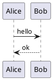
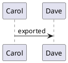
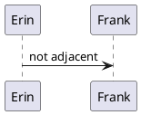

# rendermark 수동 확인 샘플 (R8)

이 문서는 `docs/rendermark_plan.md` 의 R8 절 체크리스트를 따라 열어 보는 샘플이다.
각 절 제목의 (a)~(h) 는 체크리스트 항목과 같다. 이미지는 `rendermark_manual_assets/` 의 작은 PNG 를 쓴다
(빨강 240x120, 파랑 120x120, 초록 160x80). 저장해서 문서를 바꿨다면 `git restore tests/manual/rendermark_manual.md`.

## (a) 표준 이미지: 한 번만 그려진다

아래 이미지는 정확히 한 번, 한 칸 크기로 보여야 한다 (소스 `` 는 숨고, 커서를 올리면 보인다).


문장 중간의 이미지  뒤에 글이 이어진다.

## (b) 표, 한 줄 여러 이미지

| 이름 | 그림 |
| --- | --- |
| 표 안의 빨강 |  |
| 표 안의 파랑 |  |

한 줄에 세 개:   

없는 파일은 오류 박스: 

SVG 는 지원하지 않으므로 오류 박스: 

코드 안은 그리지 않는다. 인라인 코드 `` 와 아래 펜스:

```md

```

### 스크롤 확인용 채움 (이 아래로 스크롤하면 이미지가 일부만 보이는 위치를 만들 수 있다)

채움 줄 01
채움 줄 02
채움 줄 03
채움 줄 04
채움 줄 05
채움 줄 06
채움 줄 07
채움 줄 08
채움 줄 09
채움 줄 10
채움 줄 11
채움 줄 12
채움 줄 13
채움 줄 14
채움 줄 15
채움 줄 16
채움 줄 17
채움 줄 18
채움 줄 19
채움 줄 20


채움 줄 21
채움 줄 22
채움 줄 23
채움 줄 24
채움 줄 25
채움 줄 26
채움 줄 27
채움 줄 28
채움 줄 29
채움 줄 30

## (c) plantuml 블록: 이미지 대체, 커서 진입, 저장 시 갱신

열면 렌더되어 이미지로 바뀐다 (`render_on_open`). 블록 안으로 커서를 옮기면 소스가 드러나고 미리보기가 뜬다.
`Alice -> Bob: hello` 를 `hello again` 으로 고친 뒤 `:w` 하면 잠시 뒤 이미지가 새로 그려진다.



## (d) 렌더 실패: `[diagram: ...]`

문법 오류라 plantuml 이 실패한다. 블록 끝에 `[diagram: ERROR]` 같은 경고 줄이 보이고 소스는 그대로 남는다.

```plantuml
@startuml
this is ( not valid
@enduml
```

## (e) 내보낸 이미지가 아래에 붙은 블록

아래 블록 바로 밑(빈 줄 0~1개)에 이미지 링크가 있으므로 블록 이미지는 그리지 않고 소스를 그대로 두며, 링크 이미지만 보인다.




아래 블록은 링크와 빈 줄이 2개 떨어져 있으므로 블록 이미지와 링크 이미지가 둘 다 그려진다.




## (h) 참조형 · HTML · 위키 이미지

참조형: ![ref alt][redref] 와 단축형 ![redref] 는 아래 정의를 쓴다.

HTML:  (width 120 이면 폭 120 px 로 표시)

위키 경로형: ![[rendermark_manual_assets/rm_blue.png]] 와 너비 옵션 ![[rendermark_manual_assets/rm_blue.png|60]]

위키 이름형: ![[rm_green.png]] (문서 폴더에 없으면 프로젝트 루트 아래를 비동기로 찾는다. 찾는 동안은 소스 그대로이다.)

[redref]: rendermark_manual_assets/rm_red.png
